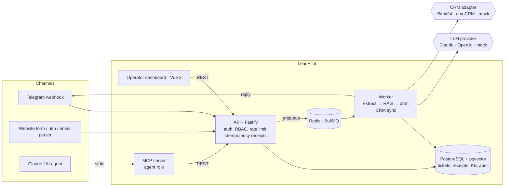
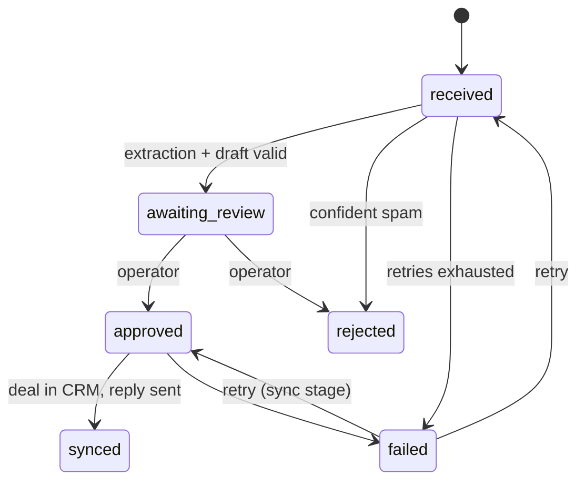

# LeadPilot

**AI intake copilot for sales and support teams.** LeadPilot takes incoming customer messages from Telegram, website forms, email or any HTTP source. It classifies each message, pulls out the contact details and budget, and drafts a reply from your knowledge base. An operator reviews the result in one click, and the deal is then created in **Bitrix24** or **amoCRM**. An **MCP server** lets Claude, or any other agent, work with the same data under a restricted role.

[](https://github.com/yaon1/leadpilot/actions/workflows/ci.yml)


Runs fully offline by default: a deterministic mock LLM and a Postgres-backed mock CRM mean `docker compose up` works without a single API key, and so do the tests and the eval.

> Краткое описание на русском — [ниже](#по-русски).

---

## The problem

A typical small or mid-size company gets leads and support requests in several places at once: a Telegram bot, a website form, a mailbox. A manager reads each message and copies the name, phone and budget into the CRM. They look up prices in a wiki and write a reply. This is slow, and phone numbers come out in five different formats. Some leads never reach the CRM at all.

Plugging an LLM straight into the CRM makes the problem worse. The model invents fields, breaks the JSON and replies to customers with prices nobody approved. A webhook retry can create the same deal twice.

## What LeadPilot does

| Step | What happens | Why it matters |
|---|---|---|
| **Ingest** | `POST /v1/inbound` or the Telegram webhook, with an `Idempotency-Key` | Retries from forms, n8n/Make or Telegram never create duplicate tickets or deals |
| **Extract** | The LLM returns intent, name, phone (E.164), email, product, budget and urgency, **validated by a Zod schema**. Invalid output is sent back to the model with the exact errors (retry-with-error) | The CRM only gets clean, typed data |
| **Retrieve** | Semantic search over the company knowledge base (**pgvector**, HNSW) | Replies are grounded in real prices and policies |
| **Draft** | The LLM drafts a reply and cites the sources it used. The citations are checked: a reply that cites a source that does not exist is rejected and regenerated | No invented discounts or deadlines |
| **Review** | An operator approves or edits the reply and fields in the Vue dashboard (human-in-the-loop). Confident spam is rejected automatically | AI speeds people up instead of replacing them |
| **Sync** | A background job creates the contact and deal in **Bitrix24 / amoCRM**, adds the reply as a note and answers the customer in Telegram | Every step is idempotent and safe to retry |
| **Observe** | Prometheus metrics, OpenTelemetry traces, an audit trail per ticket, and an eval harness for prompts | You can see what the model does and catch regressions in CI |

## Architecture



Ticket lifecycle (a compare-and-set state machine in Postgres):



## Tech stack

| Area | Choice |
|---|---|
| Language | TypeScript (strict), pnpm workspaces monorepo |
| API | Node 22, Fastify 5, Zod 4 |
| Data | PostgreSQL 17 + pgvector (HNSW, cosine), plain SQL migrations under an advisory lock |
| Queue | Redis 7 + BullMQ (exponential backoff, deduplicated job ids, non-retryable errors) |
| LLM | Provider interface: Anthropic Claude (official SDK, native structured outputs), OpenAI or any OpenAI-compatible endpoint (JSON mode), deterministic mock |
| Embeddings | Feature-hashing embeddings (offline) or OpenAI `text-embedding-3-small` at 256 dimensions |
| CRM | Adapters for Bitrix24 REST (webhook), amoCRM API v4, and a mock |
| Frontend | Vue 3, Vue Router, Tailwind CSS 4, Vite |
| Agents | MCP server built on the official `@modelcontextprotocol/sdk` (stdio) |
| Observability | OpenTelemetry (OTLP, auto-instrumented http/pg/redis plus manual LLM and CRM spans), Prometheus (`prom-client`), Grafana dashboard, Jaeger |
| Delivery | Docker multi-target image, Docker Compose, Helm chart (HPA, hook-based migrations, ServiceMonitor), GitHub Actions |
| Tests | Vitest; unit tests, plus integration tests on real Postgres/pgvector and Redis via Testcontainers; MCP tests over an in-memory transport |

```
apps/api              REST API + worker (same image, different command)
apps/web              operator dashboard
packages/shared       Zod schemas shared by API, dashboard and MCP server
packages/mcp-server   MCP server for Claude Desktop / Claude Code / any MCP client
deploy/helm           Helm chart
deploy/docker         nginx, Prometheus, Grafana provisioning
scripts/demo.sh       end-to-end demo against a running stack
```

## Quick start

Requirements: Docker. Node 22 and pnpm are only needed for development.

```bash
git clone https://github.com/yaon1/leadpilot && cd leadpilot
cp .env.example .env
docker compose up -d --build        # postgres, redis, migrations + seed, api, worker, web
./scripts/demo.sh                   # run the whole flow from the terminal
```

- Dashboard: http://localhost:8080. Sign in with the API key from `DEMO_OPERATOR_KEY` (or `DEMO_ADMIN_KEY` to edit the knowledge base). Set `WEB_PORT` if 8080 is taken.
- API: http://localhost:3000 (`/healthz`, `/readyz`, `/metrics`)
- Observability: `docker compose --profile observability up -d`, then set `OTEL_EXPORTER_OTLP_ENDPOINT=http://jaeger:4318` in `.env`. Grafana runs at http://localhost:3001, Jaeger at http://localhost:16686 and Prometheus at http://localhost:9090.

Switching to real services is configuration only:

```bash
LLM_PROVIDER=anthropic ANTHROPIC_API_KEY=sk-ant-...           # Claude; model defaults to claude-opus-5-5
CRM_PROVIDER=bitrix24 BITRIX24_WEBHOOK_URL=https://<portal>.bitrix24.ru/rest/1/<token>/
CRM_PROVIDER=amocrm AMOCRM_BASE_URL=https://<sub>.amocrm.ru AMOCRM_ACCESS_TOKEN=...
TELEGRAM_BOT_TOKEN=... TELEGRAM_WEBHOOK_SECRET=...            # then call setWebhook with secret_token
```

### Demo scenario

What `scripts/demo.sh` does, step by step:

1. A website form sends *"Hi, I'm Anna. How much is a Bitrix24 integration? Budget 150k. Phone 8 (912) 345-67-89"*.
2. The client sends the same request again (a network retry). It gets the same ticket back and `Idempotent-Replayed: true`.
3. The worker extracts `{intent: new_lead, customerName: Анна, phone: +79123456789, budgetRub: 150000, product: Интеграция с Битрикс24}`. It finds the pricing article in the knowledge base and drafts a reply that quotes the real price.
4. An `agent` key (the one the MCP server uses) tries to approve and gets `403`. Only a human operator can approve.
5. The operator approves. The deal appears in the CRM once, with the contact, the amount and the reply as a note.
6. `/metrics` shows the inbound, LLM and transition counters.

### Use it from Claude (MCP)

```bash
pnpm install && pnpm build
```

```json
{
  "mcpServers": {
    "leadpilot": {
      "command": "node",
      "args": ["/path/to/leadpilot/packages/mcp-server/dist/index.js"],
      "env": { "LEADPILOT_API_URL": "http://localhost:3000", "LEADPILOT_API_KEY": "lp_dev_agent_change_me" }
    }
  }
}
```

Tools: `list_tickets`, `get_ticket`, `search_deals`, `search_knowledge_base`, `create_crm_task` and `submit_message`. You can then ask, for example: *"Which urgent requests are waiting for review? For the Bitrix24 lead from Anna, create a task to call her back tomorrow at 10."*

## Development

```bash
pnpm install
docker compose up -d postgres redis
pnpm --filter @leadpilot/api migrate && pnpm --filter @leadpilot/api seed
pnpm --filter @leadpilot/api dev          # API on :3000
pnpm --filter @leadpilot/api dev:worker   # worker
pnpm --filter @leadpilot/web dev          # dashboard on :5173 (proxies /api)

pnpm lint && pnpm typecheck
pnpm test                 # unit tests: shared, api, mcp-server, web
pnpm test:integration     # api + worker against real Postgres/pgvector and Redis (Testcontainers, needs Docker)
pnpm eval                 # prompt eval on the labelled dataset
```

### Eval

`apps/api/eval/dataset.json` holds 30 labelled Russian and English messages: leads, support requests, complaints, spam, other, and a few deliberately hard cases such as sarcasm or an existing customer asking for an upsell. `pnpm eval` reports intent accuracy, accuracy per field (phone, email, budget, product, urgency, name), a confusion matrix, the number of attempts until the output was valid, and latency. It exits non-zero below `EVAL_MIN_INTENT_ACCURACY` (0.8 by default), so CI catches a prompt change that makes results worse. Run the same command with `LLM_PROVIDER=anthropic` or `openai` to compare models on the same data. On this dataset the keyword-based mock scores 90% intent accuracy and misses the sarcasm and English cases, which is where an LLM is supposed to win.

## Design decisions

**Idempotency, at three levels.**
1. *Command level.* `Idempotency-Key` works the same way as Stripe's. A receipt journal (`idempotency_receipts`) records `processing → completed` along with the stored response. A repeat with the same key and payload replays that response. The same key with a different payload returns `422`, and a concurrent duplicate gets `409` with `Retry-After`. If the handler fails, its receipt is released so the client can retry. Telegram's `update_id` and the source `externalId` are used as natural keys.
2. *Data level.* A unique constraint on `(tenant, channel, external_id)` protects against duplicates even if the receipts are purged.
3. *Side-effect level.* Before creating a deal, the CRM sync looks it up by our ticket id: `ORIGIN_ID` in Bitrix24, a lead reference in amoCRM. It saves the deal id and stamps `reply_sent_at` before the status changes, so a worker that crashes halfway through never creates a second deal or sends a second message. Job ids are deterministic, so enqueuing the same work twice does nothing. The integration tests cover parallel bursts on one key and a crash simulated in the middle of a sync.

**LLM output is untrusted input.** Every model answer is parsed and validated against the same Zod schema the API uses, plus business rules: cited sources must exist, and a reply that cites nothing must be flagged `needsHuman`. Failures go back to the model as a follow-up turn listing the exact errors, up to `LLM_MAX_ATTEMPTS`. Transport errors are retried by the queue with backoff. Validation that keeps failing, and 4xx errors from the CRM, are marked `UnrecoverableError` so they do not waste retries. With Claude, the provider also uses native structured outputs (a JSON schema built from the same Zod schema) and a server-side refusal fallback. Customer text is wrapped and labelled as data in the prompts, as a first line of defense against prompt injection, and the model never gets write access to anything: writes happen only after a person approves.

**RAG that is easy to inspect.** Documents are split on sentence boundaries with one sentence of overlap, embedded with the title as a prefix, and stored in pgvector with an HNSW cosine index. Every query is scoped to one tenant. The dashboard shows which sources were retrieved, their scores, and which of them the draft actually used. The embedding provider can be swapped, and the hashing embedder keeps tests and the demo deterministic.

**Secrets and keys.** API keys are random, stored only as SHA-256 hashes, and can be revoked. Provider and CRM credentials come from the environment, or in Kubernetes from a Secret or External Secrets. Configuration is validated at startup and the service fails fast if a selected provider has no key. Authorization headers and the Telegram secret are redacted in logs, and the Telegram secret is compared in constant time. The repository contains no secrets, only `.env.example` with placeholder values for local development.

**Multi-tenancy and roles.** Every table carries `tenant_id`, and every query is scoped to the tenant of the API key. The integration tests check that another tenant gets `404`. There are three roles. `admin` has full access, including the knowledge base. `operator` reviews tickets. `agent` (for the MCP server and automations) can read, search, submit messages and create CRM tasks, but **cannot approve** anything that reaches a customer. Rate limiting is per key and stored in Redis.

**Boring infrastructure.** One image runs as the API, the worker or the migration job. Migrations are plain SQL under a Postgres advisory lock, run as a Helm pre-upgrade hook. Containers run as non-root with a read-only root filesystem, and the worker gets a graceful shutdown period so in-flight LLM calls can finish.

## Roadmap

- [ ] Email channel (IMAP / inbound webhook) and a WhatsApp adapter
- [ ] Hybrid search (BM25 + vector) and re-ranking, with retrieval metrics in the eval
- [ ] LLM-as-judge eval for draft quality, and a regression report posted as a PR comment
- [ ] Per-tenant settings in the database (CRM credentials encrypted with a KMS key, prompts, pipelines)
- [ ] Prompt and response caching, and a cost per ticket metric
- [ ] SSO for operators (OIDC), with an audit log export
- [ ] Two-way sync: CRM stage-change webhooks update ticket status

---

## По-русски

**LeadPilot** — AI-ассистент для отдела продаж и поддержки. Он принимает обращения из Telegram, с форм сайта и по почте. Каждое сообщение классифицируется (заявка, поддержка, жалоба, спам), из текста извлекаются имя, телефон в формате E.164, email, продукт и бюджет. Модель проверяется по JSON-схеме и при ошибке получает её текст и исправляет ответ. Черновик ответа клиенту строится по базе знаний компании (RAG на pgvector) со ссылками на источники. Оператор одобряет или правит ответ в дашборде, после чего сделка и контакт создаются в **Битрикс24** или **amoCRM**, а клиент получает ответ в Telegram.

Что интересно с инженерной стороны:

- **Идемпотентность.** Журнал квитанций по `Idempotency-Key`: повторный запрос получает сохранённый ответ, тот же ключ с другим телом — 422, параллельный дубль — 409. Сделка в CRM не дублируется при ретраях и падении воркера: перед созданием ищем по `ORIGIN_ID`.
- **Валидация ответов LLM.** Zod-схемы, retry-with-error, бизнес-правила (нельзя ссылаться на несуществующий источник), невосстановимые ошибки не ретраятся.
- **Human-in-the-loop и роли.** Агент через MCP может искать сделки и ставить задачи, но одобрить ответ клиенту может только человек.
- **MCP-сервер.** Claude Desktop или Claude Code работает с системой через инструменты: поиск сделок, тикеты, база знаний, задачи в CRM.
- **Eval-набор.** 30 размеченных обращений; точность классификации и извлечения полей, CI падает при регрессии.
- **Наблюдаемость и деплой.** OpenTelemetry, Prometheus и Grafana, Docker Compose одной командой, Helm-чарт, GitHub Actions.

Запуск без ключей: `cp .env.example .env && docker compose up -d --build && ./scripts/demo.sh`. Для работы с реальными сервисами нужно указать `LLM_PROVIDER=anthropic`, `CRM_PROVIDER=bitrix24` или `amocrm` и соответствующие ключи в `.env`.

## License

[MIT](LICENSE)
